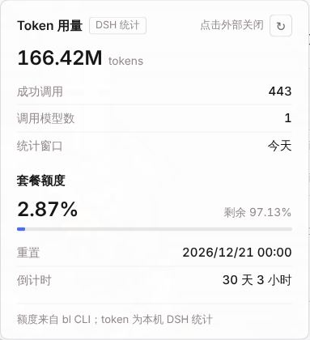
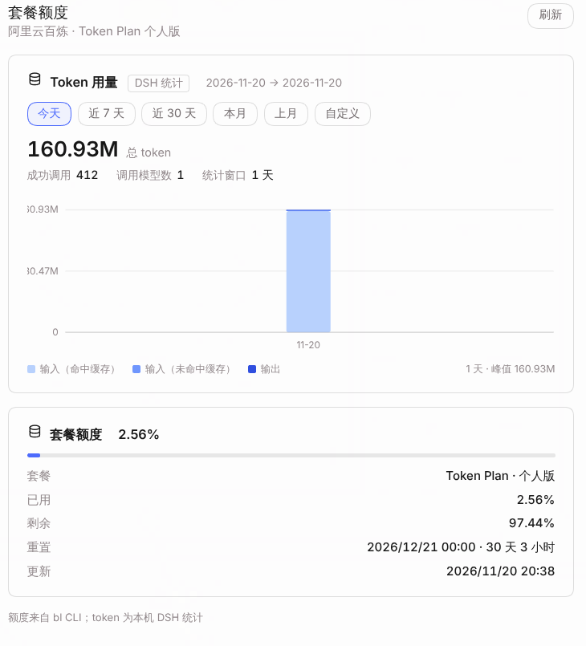

<div align="center">


# dsh-bailian-quota

**See your Aliyun Bailian Token Plan allowance and this machine's token usage inside DeepSeek Harness.**

A `Plan 1.24%` pill in the composer row opens a card with token usage and the monthly allowance; Settings adds a per-day stacked usage chart.

[中文](README.md) · English

<a href="LICENSE"></a>


</div>

## Why it exists



A Token Plan key (`sk-sp-…`) can call models but **cannot read its own allowance**, and the console exposes no public quota API. This plugin reuses the official CLI session you already have and reads what this command prints:

```bash
bl usage token-plan --output json
```

It **never reads, stores, or transmits an API key**, and never touches `~/.bailian/config.json`.

<br clear="all">

## What you get

- **Composer pill**: `Plan 1.24%`, two decimals. The dot shifts colour as the month fills (green <70%, amber ≥70%, orange ≥90%, red ≥100%). When the plan expires, the CLI is logged out, or the console returns no quota, the pill **renders nothing** — no empty slot, no squeezed permission or model labels.
- **Popover on click**: this machine's token usage (total, calls, models, window) plus the allowance (used, left, reset time, countdown). Closes on `Esc` or an outside click.
- **Settings → Bailian quota**: window presets `Today / Last 7 days / Last 30 days / This month / Last month / Custom dates`; a three-segment stacked bar chart (cached input / uncached input / output) with a per-day hover card; and an allowance card with a progress bar and detail rows.

<p align="center">
  
</p>

## Install

**Prerequisite: log in to the Bailian CLI**

```bash
npm i -g bailian-cli
bl auth login          # browser login, or bl auth login --open-api with AK/SK
bl usage token-plan --output json
```

You are ready once that prints `{"per1MonthPercentage":…,"per1MonthResetTime":…,"hasQuotaData":true}`.

**Option 1 — from GitHub (recommended)**

In DSH, open **Plugins → Add plugin** and enter:

```
github:KNtnx/dsh-bailian-quota
```

Or from a shell:

```bash
dsh plugin --profile web add github:KNtnx/dsh-bailian-quota
```

**Option 2 — from a local checkout**

```bash
git clone https://github.com/KNtnx/dsh-bailian-quota.git
dsh plugin --profile web add link:./dsh-bailian-quota
```

Swap `web` for your profile name (the desktop build usually uses `desktop`). Restart `dsh web` afterwards.

## Two data sources

| Figure | Source | Notes |
|---|---|---|
| Used / left / resets | `bl usage token-plan` | The console returns a **percentage** and a reset instant only — no token counts |
| Total tokens / calls / models / daily chart | **Local DSH accounting** | Replays `request/header` and `assistant/message` from `$DSH_HOME/sessions/**/session.v4.jsonl.zstd`, counting only `qwen-token-plan*` routes |

So the token figures mean "Token Plan calls this machine sent through DSH". They are **not** the console's billing numbers and exclude other clients; the UI labels them `DSH stats`.

The console's usage-detail page (total tokens, cache hit rate) belongs to the Token Plan product and has no `bl` command; `bl usage stats` reports the pay-as-you-go workspace, which is a different set of calls. Neither is mixed in.

## Configuration

| Setting | Default | Notes |
|---|---|---|
| `DSH_BAILIAN_BL` | auto-detected | Path to the `bl` binary, used when PATH, `~/.local/bin`, `/usr/local/bin` and the fnm install dir all miss |
| Usage window | last 7 days | Chosen in Settings, stored in browser `localStorage` (`dsh.bailianQuota.window`); the popover follows it read-only |
| Refresh | 60 s | The allowance is cached for 60 s; ↻ in the card and Refresh in Settings force a re-read |

## Privacy

- Only runs `bl usage token-plan --output json` and reads local session logs;
- Session logs are cached per file by mtime under `$DSH_HOME/storages/bailian-quota/` and never uploaded;
- Both HTTP routes accept loopback requests only;
- No access to `~/.bailian/config.json`, no API key handling.

## Troubleshooting

| Symptom | Fix |
|---|---|
| No pill at all | Plan expired, `bl` logged out, or the console returned no `hasQuotaData`. Run `bl usage token-plan` once to check |
| Numbers look stale | The cache lives 60 s; press ↻ or Refresh in Settings. If it still will not move, restart `dsh web` |
| Token usage stays at 0 | Only `qwen-token-plan*` routes are counted — confirm the session uses that provider |
| `bl` not found | Install `bailian-cli`, or set `DSH_BAILIAN_BL=/path/to/bl` |

## Development

```bash
node --check index.js
node --check client.js
dsh plugin --profile web add link:$(pwd)
```

```
package.json        plugin manifest (dsh.bundle.patch + dsh.client)
cordis.patch.yml    host row insertion
index.js            host: bl CLI reads, session replay, HTTP routes
client.js           browser: pill, popover, settings page, chart
locale/             marketplace strings
docs/DETAIL.md      detail page
```

## License

[MIT](LICENSE)

[](https://github.com/deepseek-ai/deepseek-harness)