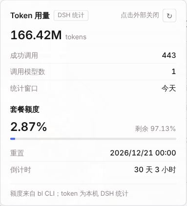
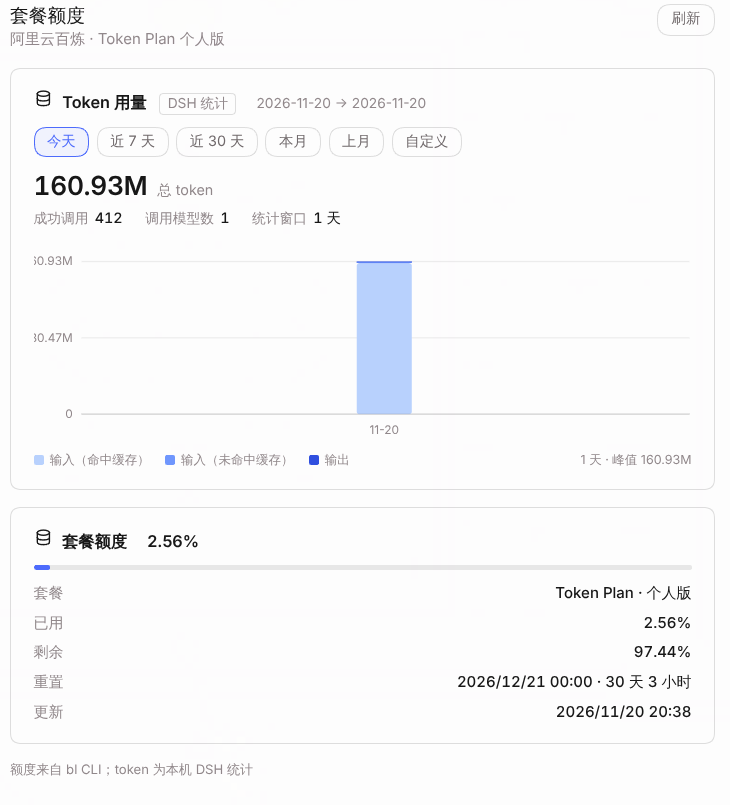

<div align="center">


# dsh-bailian-quota

**在 DeepSeek Harness 里查看阿里云百炼 Token Plan 的额度与本机 Token 用量。**

工具行一枚 `套餐 1.24%` 胶囊，点开是 Token 用量 + 套餐额度卡片，设置页可按天看堆叠用量图。

[中文](README.md) · [English](README.en.md)

<a href="LICENSE"></a>


</div>

<table>
<tr>
<td valign="top">

## 为什么需要它

Token Plan 的专属 API Key（`sk-sp-` 开头）**只能调用模型，查不了额度**，控制台也没有公开的额度接口。本插件复用你已经登录的官方 CLI，读取下面这条命令的结果：

<pre><code>bl usage token-plan --output json</code></pre>

它**不读取、不保存、不传输任何 API Key**，也不会碰 `~/.bailian/config.json`。

</td>
<td valign="top" width="360">

</td>
</tr>
</table>

## 功能

- **工具行胶囊**：`套餐 1.24%`，两位小数。颜色随用量变化（<70% 绿、≥70% 琥珀、≥90% 橙、≥100% 红）；套餐失效 / 未登录 / 读不到数据时**整枚不渲染**，不占位、不挤压权限与模型名。
- **点击弹出卡片**：本机 Token 用量（总量 / 调用次数 / 模型数 / 统计窗口）+ 套餐额度（已用、剩余、重置时刻、倒计时）。`Esc` 或点击外部关闭。
- **设置 → 百炼额度**：统计窗口可选 `今天 / 近 7 天 / 近 30 天 / 本月 / 上月 / 自定义日期`；三段堆叠柱状图（命中缓存 / 未命中缓存 / 输出），悬停显示当日明细；套餐额度卡片带进度条与明细行。

<p align="center">
  
</p>

## 安装

**前置：登录百炼 CLI**

```bash
npm i -g bailian-cli
bl auth login          # 浏览器登录；或 bl auth login --open-api 用 AK/SK
bl usage token-plan --output json
```

能输出 `{"per1MonthPercentage":…,"per1MonthResetTime":…,"hasQuotaData":true}` 即可。

**方式一：从 GitHub 安装（推荐）**

在 DSH 的 **插件 → 添加插件** 里填：

```
github:KNtnx/dsh-bailian-quota
```

或命令行：

```bash
dsh plugin --profile web add github:KNtnx/dsh-bailian-quota
```

**方式二：本地目录**

```bash
git clone https://github.com/KNtnx/dsh-bailian-quota.git
dsh plugin --profile web add link:./dsh-bailian-quota
```

把 `web` 换成你实际的 profile（Desktop 版通常是 `desktop`）。安装完重启 `dsh web`。

## 两种数据来源

| 数字 | 来源 | 说明 |
|---|---|---|
| 已用 / 剩余 / 重置 | `bl usage token-plan` | 控制台只返回**比例**与重置时刻，没有 token 数 |
| 总 token / 调用次数 / 模型数 / 每日图表 | **本机 DSH 统计** | 重放 `$DSH_HOME/sessions/**/session.v4.jsonl.zstd` 的 `request/header` 与 `assistant/message`，只累计 `qwen-token-plan*` 路由 |

因此 token 数是「这台机器经 DSH 发出的 Token Plan 调用」，**不是控制台账单口径**，也不含其它客户端；界面上标注为 `DSH 统计`。

控制台「用量详情」页的总 token / 缓存命中率属于 Token Plan 产品口径，`bl` 目前没有对应命令；`bl usage stats` 查的是按量计费工作空间，与 Token Plan 不是同一批调用——两者都没有混进来。

## 配置

| 项 | 默认 | 说明 |
|---|---|---|
| `DSH_BAILIAN_BL` | 自动探测 | 指定 `bl` 可执行文件路径（PATH、`~/.local/bin`、`/usr/local/bin`、fnm 安装目录都找不到时用） |
| 统计窗口 | 近 7 天 | 设置页选择，存于浏览器 `localStorage`（`dsh.bailianQuota.window`），弹层只读跟随 |
| 刷新 | 60 秒 | 额度缓存 60 秒；卡片右上角 ↻ 与设置页「刷新」强制重读 |

## 隐私

- 只执行 `bl usage token-plan --output json`，并只读本机会话日志；
- 会话日志按文件 mtime 增量缓存到 `$DSH_HOME/storages/bailian-quota/`，不上传；
- 两个 HTTP 路由只接受 loopback 请求；
- 不读 `~/.bailian/config.json`，不接触 API Key。

## 排错

| 现象 | 处理 |
|---|---|
| 胶囊不显示 | 套餐过期、`bl` 未登录、或控制台没返回 `hasQuotaData`。先跑一次 `bl usage token-plan` 确认 |
| 数字不更新 | 缓存 60 秒；点 ↻ 或设置页「刷新」。仍不动就重启 `dsh web` |
| Token 用量一直是 0 | 只统计 `qwen-token-plan*` 路由；确认当前会话用的是这个 provider |
| 找不到 `bl` | 装 `bailian-cli`，或设 `DSH_BAILIAN_BL=/path/to/bl` |

## 开发

```bash
node --check index.js
node --check client.js
dsh plugin --profile web add link:$(pwd)
```

```
package.json        插件清单（dsh.bundle.patch + dsh.client）
cordis.patch.yml    宿主行插入
index.js            宿主：bl CLI 读取、会话重放、HTTP 路由
client.js           浏览器：胶囊、弹层、设置页、图表
locale/             插件市场展示文案
docs/DETAIL.md      插件详情页
```

## License

[MIT](LICENSE)

[](https://github.com/deepseek-ai/deepseek-harness)
